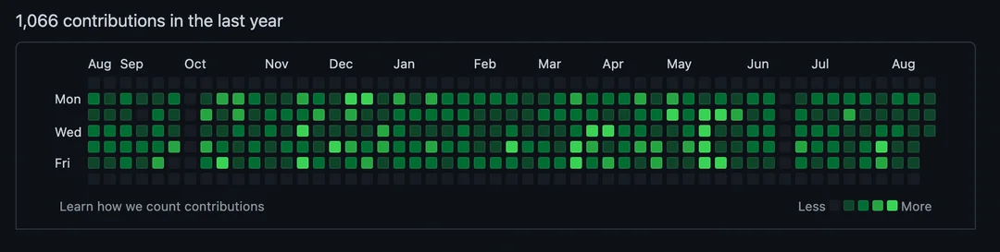

# gogreen-mvp

**Design your contribution graph, then build it.**

[](https://nodejs.org)
[](package.json)
[](test)
[](LICENSE)
[](https://github.com/niihhhall/gogreen-mvp/pulls)



A GitHub profile is read in about four seconds. Before anyone opens a repository, clicks a pin, or reads a line of code, they see one thing: the contribution graph. It is the only part of a profile that communicates volume, rhythm, and consistency at a glance.

`gg` turns that graph into something you control. You describe a shape — a date range, a density, a seed — and it prints an exact preview of the calendar before a single commit exists. When the preview looks right, you apply it.

No dependencies. No configuration files. One command.

```
     Jan       Feb     Mar     Apr     May     Jun     Jul     Aug     Sep     Oct     Nov       Dec
Sun    ▓ ▓ ▒ ▓ ▓ ▒ · ▓ · ▓ ▓ ▓ · ▒ ▓ · ▒ ▓ ▓ ▒ ▓ ▒ ▓ · ▓ ▓ ▓ ▒ ▓ ▒ ▓ ▓ ▓ ▒ ▒ ▒ ▓ ▓ ▓ ▒ ▓ ▓ · ▒ ▓ ▓ ▒ · ▒ · ▒ ▓
Mon    · ░ ▒ ▒ ░ ░ ░ ░ ▒ ░ · · · ░ ░ · ░ ░ ▒ ░ ▒ ▒ ░ ▒ · ▒ ░ ▒ ▒ ▒ ░ · ░ ▒ ░ ▒ ▒ ▒ ▒ · ░ ░ ░ · ▒ ▒ ▒ ░ ▒ ░ ▒ ░
Tue    · ░ ░ ▒ ░ ░ ▒ · ░ ▒ ░ ▒ ░ · ▒ ▒ ▒ ░ ░ ░ · ▒ ░ ▒ · ▒ ░ ▒ ▒ ░ ▒ ░ ▒ ░ ▒ ▒ · ░ ░ · ▒ ░ · ▒ · ░ ▒ ▒ ░ · ▒ ▒
Wed  ░ ░ ░ · ░ ░ ░ ▒ ▒ ▒ ░ ▒ ░ ░ ░ ▒ ░ ▒ · ▒ ░ ░ ░ ▒ · · ░ · ░ ░ ▒ ░ ░ ▒ ░ ░ ▒ ▒ ░ ░ ▒ ▒ ▒ ▒ ░ ▒ · ░ ▒ ░ ▒ ▒ ░
Thu  ▒ ▒ · ░ ▒ ▒ ▒ · ▒ ▒ · ▒ ░ ▒ ▒ ░ ▒ ▒ ▒ ▒ ▒ · ░ · ░ · ▒ ▒ · ▒ ░ ░ · ▒ ░ ▒ ▒ ░ ░ ░ ▒ ░ ░ · ▒ ▒ ░ ░ ▒ ▒ ░ ▒
Fri  ░ ░ ░ ░ · ░ ▒ ▒ ░ ░ · · ░ ▒ ░ ▒ ░ ▒ ░ ▒ ▒ ░ ▒ ░ ▒ ░ ▒ ░ · · ░ · ░ ░ ▒ ░ ▒ · ▒ ▒ ░ ▒ ▒ ▒ ▒ ░ ░ ░ ▒ ▒ · ░
Sat  ▓ ▓ ▒ ▓ · ▓ ▓ ▒ ▓ ▒ ▒ ▓ ▓ ▒ ▒ ▓ · ▓ ▒ · ▓ · ▓ ▓ ▒ ▓ · ▓ ▓ ▒ · ▓ ▓ ▒ ▓ ▒ ▒ · · ▓ ▒ ▓ · ▓ ▒ ▒ ▓ ▓ ▓ ▓ ▓ ▓
     less · ░ ▒ ▓ █ more

profile     premium  (seed "showcase")
range       Wed, 1 Jan 2025 → Wed, 31 Dec 2025
commits     1123
active days 306 of 365
rest days   59
peak        9 commits on a single day
```

That preview is real, reproducible output. The same `--seed` always produces the same graph.

---

## Why the shape matters more than the number

A graph that is uniformly dark reads as noise. A graph that is uniformly empty reads as absence. What actually looks credible is **contrast**: dense weekends, quieter weekdays, a handful of genuinely empty days, and no single day that spikes absurdly above the rest.

`gg` is built around that idea. Every profile is a distribution, not a flat count:

| Profile | Character | Approx. commits / year |
| --- | --- | --- |
| `subtle` | Low-key presence. Mostly open calendar with a scattering of marks. | ~250 |
| `balanced` | Steady weekday rhythm, weekends visibly stronger. | ~750 |
| `premium` | Deep, consistent coverage with texture. **Default.** | ~1,100 |
| `dense` | Maximum saturation. No contrast left — use sparingly. | ~2,300 |

Each profile also leaves a percentage of days deliberately empty. Those gaps are what make the busy days look deliberate instead of automated.

---

## Quickstart

Requires Node 18.17 or newer and git. Nothing else — there is no `npm install` step.

```bash
git clone https://github.com/niihhhall/gogreen-mvp.git
cd gogreen-mvp

# 1. Preview the current year. Nothing is written.
node bin/gg.js

# 2. Preview a specific range with a reproducible shape.
node bin/gg.js --from 2025-01-01 --to 2025-12-31 --profile premium --seed spring

# 3. Apply it, and publish.
node bin/gg.js --from 2025-01-01 --to 2025-12-31 --seed spring --apply --push
```

Install it globally if you want to run `gg` from any repository:

```bash
npm link
gg --profile balanced
```

---

## Commands

| Flag | What it does |
| --- | --- |
| `--from <YYYY-MM-DD>` | First day to cover. Defaults to 1 January of the target year. |
| `--to <YYYY-MM-DD>` | Last day to cover. Defaults to today. |
| `--profile <name>` | `subtle`, `balanced`, `premium`, or `dense`. |
| `--weekday <n>` | Fixed commits Mon–Fri. Overrides the profile — and disables rest days. |
| `--weekend <n>` | Fixed commits Sat–Sun. Same behaviour. |
| `--max-per-day <n>` | Hard ceiling on any single day. Default 18. |
| `--seed <text>` | Any string. The same seed always produces the same graph. |
| `--skip-existing` | Top up days that are below target instead of adding on top. |
| `--apply` | Actually create the commits. Without this, the run is a preview. |
| `--push` | Push when the run finishes. Requires `--apply`. |
| `--no-color` | Plain output. |

Run `gg --help` for the full reference.

---

## Recipes

**Make a full year look like sustained, deliberate work**

```bash
node bin/gg.js --from 2025-01-01 --to 2025-12-31 --profile premium --seed spring --apply --push
```

**Fill in only the gaps in the current year**

```bash
node bin/gg.js --profile balanced --skip-existing --apply --push
```

`--skip-existing` reads your real history first, counts the commits already on each date, and only creates what is missing. Run it monthly and the graph stays even without ever over-saturating a day.

**Try a few shapes before committing to one**

```bash
node bin/gg.js --from 2025-01-01 --to 2025-12-31 --seed a
node bin/gg.js --from 2025-01-01 --to 2025-12-31 --seed b
node bin/gg.js --from 2025-01-01 --to 2025-12-31 --seed c --profile balanced
```

Nothing is written until you add `--apply`, so this is free.

**Draw something deliberately even**

```bash
node bin/gg.js --from 2025-01-01 --to 2025-12-31 --weekday 2 --weekend 2 --apply
```

Fixed counts remove all randomness — every day gets exactly the number you name. Useful for bands, blocks, and patterns.

---

## How it works

Four decisions shape the whole tool.

**Empty commits, not file churn.** Every commit is created with `git commit --allow-empty`. There is no marker file being rewritten over and over, so your repository history contains nothing but the commits themselves. Nothing to clean up later.

**Both dates are backdated.** A commit carries an author date and a committer date, and most tools only set the first. `gg` sets `GIT_AUTHOR_DATE` and `GIT_COMMITTER_DATE` to the same moment, so the commit is consistent everywhere it is read.

**Deterministic by seed.** Randomness comes from a seeded generator, not `Math.random()`. The same seed and range produce a byte-identical plan, which means a preview can be reviewed, adjusted, and then applied with confidence that it is the same graph.

**History-aware.** Before planning, the tool reads the commit count for every date already in the repository — not just the ones it created. That is what makes `--skip-existing` accurate and lets you mix real work with deliberate coverage without double-counting.

### Safety rails

- The default is **preview only**. Writing requires `--apply`.
- Commits dated after today are skipped automatically.
- The run aborts if you have staged changes, so nothing of yours gets swept into an empty commit.
- A push failure leaves the commits intact locally and tells you exactly how to retry.
- Ranges are capped at ten years.

---

## Project layout

```
bin/gg.js          executable entry point
src/args.js        argument parsing and usage text
src/calendar.js    date parsing, ranges, weekend detection
src/planner.js     density profiles and plan construction
src/git.js         commit, history, and push wrappers
src/render.js      heatmap preview and progress bar
test/              unit tests (node:test, no dependencies)
```

The planner is pure: given a range, a profile, and a seed, it returns a plan and touches nothing. Everything that writes to disk or runs git lives in `src/git.js`. That separation is why the whole planning layer is covered by fast unit tests.

```bash
npm test
```

---

## FAQ

**Does this rewrite existing history?**
No. Every commit is new and appended to the current branch. Nothing is amended, rebased, or force-pushed.

**Will it look different on my profile than in the preview?**
The preview maps commit counts to five shade levels using the same thresholds GitHub uses. The shape will match.

**Can I undo a run?**
Yes. Every commit is empty, so `git reset --hard <ref>` before pushing removes them cleanly with no file changes to reconcile.

**Does it work on a private repository?**
Private contributions only appear on the graph if you enable *Settings → Profile → Contribution settings → Include private contributions on my profile*.

**What if I already have real commits in the range?**
They are counted. With `--skip-existing` they are respected; without it, they stack on top. Prefer `--skip-existing` when mixing real work with design.

---

## Topics

`git` · `github-profile` · `contribution-graph` · `contribution-calendar` · `heatmap` · `developer-tools` · `cli` · `nodejs` · `zero-dependencies` · `productivity` · `portfolio` · `personal-branding` · `visualisation`

---

## License

MIT © Nihal Mishra
